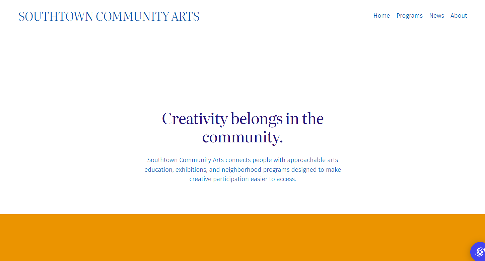
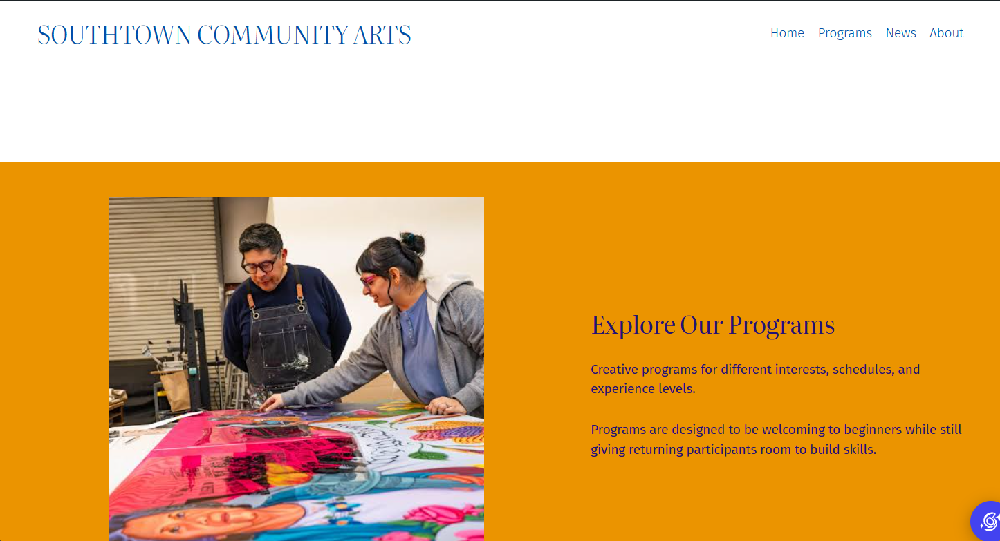
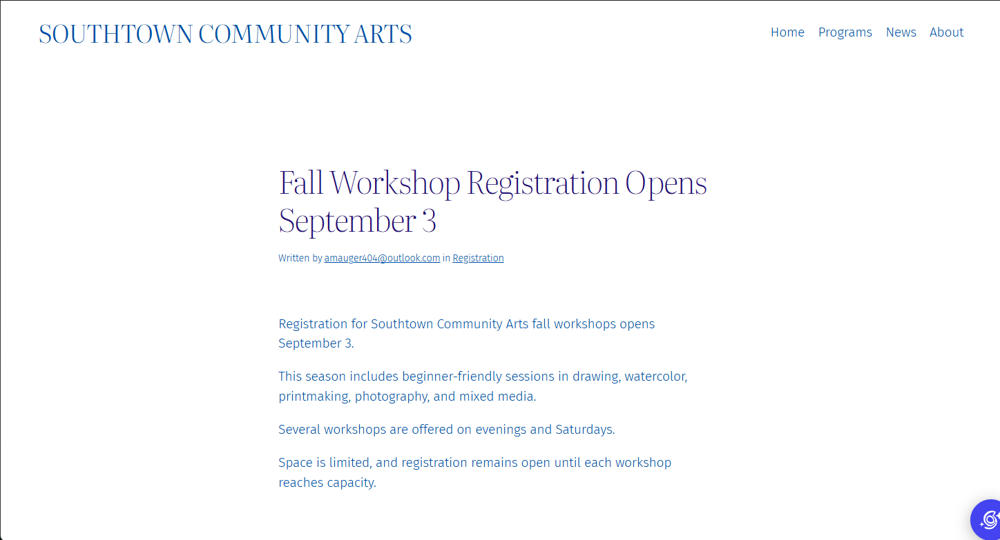
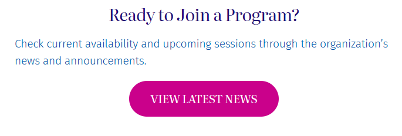
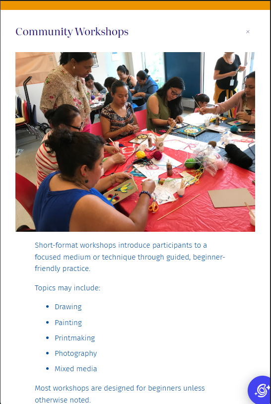

# Week 11: Build for Content — WordPress & CMS Fundamentals

## CMS Project Overview

**Client:** Southtown Community Arts  
**Role:** Junior Web / CMS Specialist  
**Week:** 11 — Build for Content: WordPress & CMS Fundamentals

Briefly summarize what you configured in WordPress.

I created three pages for Southtown Community Arts using their supllied content.

---

## WordPress Site Access

**Site URL or instructor-access information:**  
[https://susane34.sg-host.com/]

---

# Content Architecture

I organized the supplied client content as it was grouped by information. I kept all major CTAs with a yellow background to draw extra attention. I used various blocks, including headers, paragraphs, images, buttons, and columns, to lay out the information efficiently.

## Pages

List the Pages you created and briefly explain why they belong as Pages.

- **Home:** A Home page will always ne necessary as it is the introduction to the website that directs users to the information they seek.
- **Programs:** The Programs page was necessary as it is the client's main offering and therefore the information needs to be available for users to access.
- **About:** The About page contains relatively stable information that will not change and therefore works best as a page.

## Post

**News Post:** Fall Workshop Registration Opens September 3

Explain why this content belongs as a Post rather than a Page.

This content belongs as a Post since it is dated. We cannot guarantee when the user will view the website and do not want them to be confused by outdated information if they view it when it is no longer relevant.

---

# Reusable Pattern

**Pattern Name:**  
Southtown - Program Callout

**Used For:**  
The repeated content structure uses a Stack to group a Header, Paragraph, and Button to direct users to view the news post.

**Why a Pattern Was Appropriate:**  
Using a Pattern was appropriate because the button was reused and would allow for the client to update all instances at once as necessary.

---

# Site-Wide Structure

Describe the required Site Editor change you completed.

**Change:**  
I updated the content in the Header and Footer to reorganize the Navigation Menus in each. I also updated the Styles to apply different typography and color settings across the website.

**Where It Was Made:**  
I used the Site Editor to update the Header, Footer, and Styles used throughout the website.

**Why It Belongs at the Site Level:**  
Applying these updates through the Site Editor saved me timed by not requiring the blocks be applied to every page.

---

# Client Update Test

Complete `CLIENT-UPDATE.md` after the primary site build, then document the result here.

## Supplied Update

Briefly identify the client change you completed.

I updated a sentence for the Community Workshops description.

## Where I Made the Update

What WordPress content-editing area did you use?

I updated this content on the Programs page in the Paragprah block were it was located.

## Structure Check

Did you need to modify the header, footer, navigation, template, template part, or reusable pattern? Explain.

I didn't need to modify anything other than the specific block because the information was only used once.

## Maintainability Result

Explain how this update demonstrates that routine content can change without rebuilding the site's global structure.

Using blocks to group information keeps it seperate from major sections of the website. By knowing where the information was, I was able to quickly pull up the block and change the description.

---

# Accessibility & Responsive Checks

Document the quality checks you completed.

## Headings

As I went through each page I made sure that the different sections followed a logical heading hierachy.

## Images

I described what type of image it was, whether it was a painting or a photo, and listed what was included in the image.

## Links & Buttons

I clicked each button and link to ensure it went to the appropriate page.

## Keyboard

I used the keyboard to navigate across each page.

## Responsive Layout

I went through each page through wide and narrow widths to ensure everything displayed correctly.

---

# Evidence

Replace the files in the `evidence/` folder with your own screenshots using the exact required filenames.

## Home Page

## Programs Page

## News Post

## Primary Navigation

## Reusable Pattern

## Narrow-Screen / Mobile View

---

# Developer Handoff

Keep each response concise and specific to this project.

## CMS Choice

Why is WordPress an appropriate solution for Southtown Community Arts?

WordPress was an appropriate solution because of it's simplicity to maintain. Since Southtown Community Arts is a nonprofit community organization, they may not have an IT wizard on staff available to maintain the website and changes must be easy for them to complete.

## Editable Content

What information should Southtown Community Arts staff be able to update routinely?

The staff should have no problem adding posts or updating the program descriptions. Since the website uses blocks for information, they are easy to update.

## Reusable Structure

What site element did you make reusable or site-wide, and why?

I made the View Lastest News button reusuble since it was a repeated structure that was composed of three different blocks. By making it a pattern, I did not have to recreate it each time it was used.

## Client Protection

What design or architecture decision helps the site remain consistent when staff members make routine updates?

I kept all related information in its own section so changes to one thing will not affect another. 

---

# Final Handoff Check

- [x] Home, Programs, and About are published as Pages.
- [x] The supplied announcement is published as a Post.
- [x] Primary navigation works in the required order.
- [x] One meaningful reusable Pattern is present.
- [x] The required site-wide structure adjustment is complete.
- [x] I completed the supplied `CLIENT-UPDATE.md` request after the main build.
- [x] The client update did not require unnecessary global-structure changes.
- [x] Headings are logical.
- [x] Informative images have meaningful alternative text.
- [x] Link and button labels are understandable.
- [x] Keyboard focus is visible.
- [x] Narrow-screen behavior was checked.
- [x] All six evidence images display correctly in this README.
- [x] All four Developer Handoff responses are complete.
- [x] I committed and pushed this Week 11 handoff folder.
