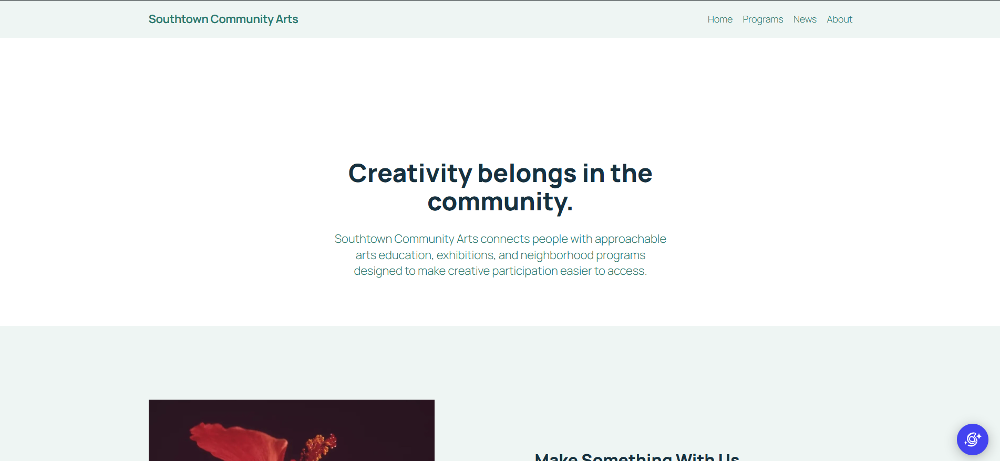
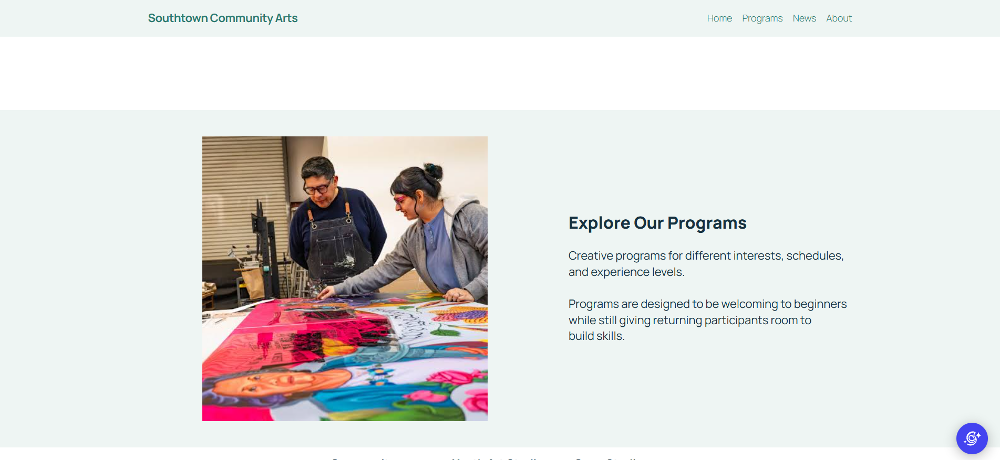
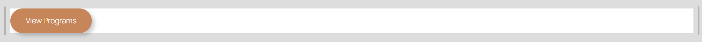
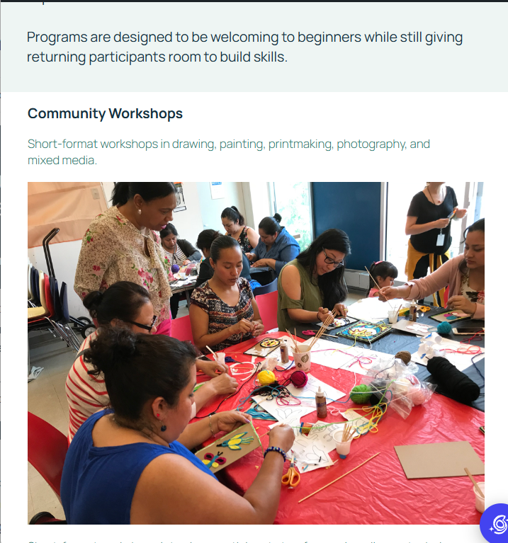

# Week 12: Customize the Experience — WordPress Development

**Client:** Southtown Community Arts  
**Role:** Junior WordPress Developer

## Project Overview

Briefly summarize how you customized the existing Week 11 CMS without making routine content harder for the client to maintain.

I used the WordPress Theme Editor to select colors and typography that matched the brand specs. I used a few patterns to simplify changes for repeated blocks.

---

# Customization Decisions

Document the four required decisions below.

## 1. Global Design System

**Requirement:**  
The color palette and typography were site wide changes.

**Location:**  
Theme Editor

**Change:**  
I changed the color palette to match the brand specs and adjusted them as needed to maintain necessary contrast. I also selected sans-serif fonts as outline.

**Why this level:**  
Making these changes on a global level helped keep everything consistent. Making these changes page by page would be time consuming and would leave more room for human error.

**QA:**  
I went through each page after making the changes to confirm the look was consistent and on brand throughout the site.

---

## 2. Branded Reusable Pattern

**Pattern:**  
Southtown - View Programs CTA

**Change:**  
I created one button that linked to the Program page and styled it to my liking and then replaced two of the buttons with the

**Reuse:**  
I reused this pattern on the home page under each program call out

**Editor value:**  
If an editor decides to change a link for this button, they will only need to update it once instead of three times.

---

## 3. Site-Wide Structure Customization

**Shared area:**  
Header

**Change:**  
I customized the typography and colors used to match the brand specs.

**Why this level:**  
Since the header includes the Navigation Menu, it is important that users know how to access it on every page and that is most effective when the look is consistent.

**QA:**  
I checked Home, Programs, News, and About to ensure the header was the same throughout.

---

## 4. Controlled Development-Level Modification

I could not figure out how to implement either a theme.json OR targeted CSS through WordPress. I spent a while trying to figure out how to find the theme.json file but every resource/tutorial I saw did not help me get closer and I decided I needed to at least complete other sections of the assignment.

---

# Visitor + Editor QA

## Visitor Experience

- [x] I tested narrow and wide viewport behavior.
- [x] I checked visual consistency on more than one page.
- [x] I checked text/link/button contrast.
- [x] I verified visible keyboard focus.
- [x] I tested navigation and links.
- [x] I checked that the brand system is consistent rather than page-specific.

### Visitor QA Notes
The focus ring for buttons when using keyboard navigation had low contrast with the background.

## Editor Experience

- [x] Routine content is still editable through WordPress.
- [x] The branded pattern is understandable to reuse/edit.
- [ ] My customization did not move ordinary client content into code.
- [x] I performed one temporary routine content edit, previewed it, and restored the original content.
- [x] The site remained visually coherent after the editor test.

### Editor QA Notes
I added small changes to the copy of paragraphs on different pages to see if it disrupted the layout or other sections of the website.

---

# Evidence

Use the exact filenames below.

## Customized Home

## Customized Programs

## Branded Reusable Pattern

## Responsive / Mobile View

## Editor Maintainability Test

---

# Maintainability Reflection

Write approximately **75–100 words** responding to:

> Give one example of a change you intentionally handled globally and one change you intentionally left as editable content. How does that separation help Southtown Community Arts maintain the site without losing design consistency?

I intentionally chose to apply global changes for the color palette and typography. These were important to maintaining brand identity but would have been tedious to manually add to every page. Since the body copies are subject to change as programs are edited, I left them as individual blocks that could be updated in the editor. Since the global changes automatically apply, there is no fear of changes hurting the design consistency throughout the site. 

---

# Final Handoff Check

- [x] I continued the Week 11 Southtown site rather than rebuilding it.
- [x] I applied the approved palette and typography direction systematically.
- [x] I used global controls for global decisions.
- [x] I created or significantly customized one branded reusable pattern.
- [x] I made one appropriate site-wide structure customization.
- [ ] I completed exactly one controlled development-level modification.
- [x] I did not add PHP, plugins, custom blocks, or a child-theme build for this assignment.
- [x] Visitor and editor QA are complete.
- [x] All five evidence screenshots display in this README.
- [x] I completed the maintainability reflection.
- [x] I committed and pushed the Week 12 handoff folder.
